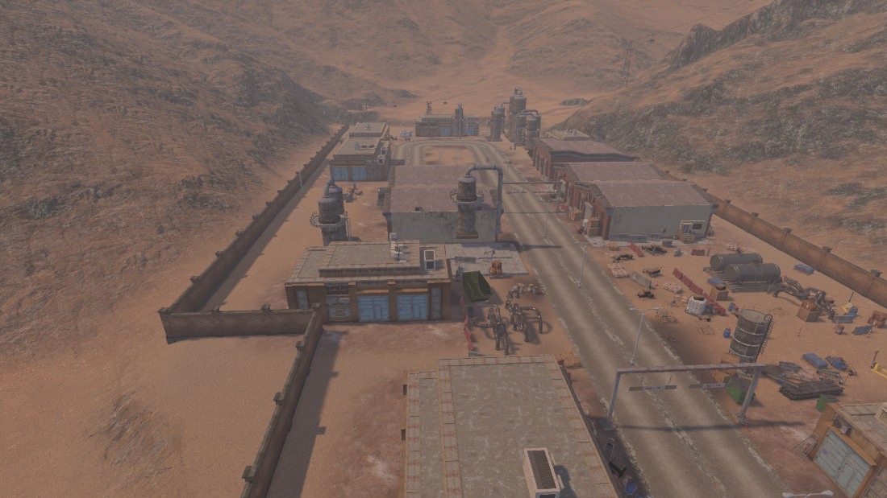

# 厂区地面

`Tools > Coal Echoes > Paint Factory Ground` 在厂区所在的 Tile 0,-1 和 Tile 0,-2（Main 与 Draft）上，在 MapMagic 的三层自然地表之后追加三层，并按场景物体自动计算分布。实现在 `Assets/Scripts/Terrain/Editor/FactoryGroundPainter.cs`，层资源在 `Assets/Art Resources/Environment/Terrain/FactoryGround/`。

| 层 | 贴图 | 分布 |
| --- | --- | --- |
| Factory_Dust | rocky_trail，4 米平铺，略压灰 | 厂区内 35% 到 90%，按 70 米低频噪声起伏，压暗橙色并打散沙地重复 |
| Factory_Compacted | aerial_ground_rock，10 米平铺 | 每栋厂房外围 5 到 8 米一圈 |
| Factory_CoalDust | ground1 深色土，颜色压到近黑 | 道路两侧 4 到 15 米、墙根 3 到 7 米，按噪声成片出现 |

厂区范围取两段围墙和厂房四角的凸包，向外 25 米噪声渐隐。厂房取 `01 建筑与构筑物` 下大型、混凝土、砖砌三组里启用的对象；道路取场景里所有 `FactoryDirtRoadSpline` 样条（厂内主路两条车道、`工厂支路` 下的支路和厂门连接路）。坡度岩石处不刷。场景里名字以 `CoalPile_` 开头的 LODGroup 视为煤堆，其下方和周围 2.5 到 4.5 米刷满煤灰，不受厂区范围限制，见[煤堆](../../ArtSource/CoalPile/README.md)。

## 注意

1. 地形超过 4 层时 HDRP 需要 `_TERRAIN_8_LAYERS`，已在共用的 `Terrain_HDRP.mat` 上打开。原生地形按实际层数循环，三层地块不多采样。
2. 移动厂房、改道路或 MapMagic 重新生成这两块后，重跑菜单即可，结果可重复，不会累积。
3. `MapMagicTerrainTextureSync` 现在识别前三层之后的额外层，改高度时自然层按剩余权重刷新，厂区层保留。
4. Scene 视图曝光偏高且有沙尘体积雾，深浅差别看不清，检查效果用游戏相机。

