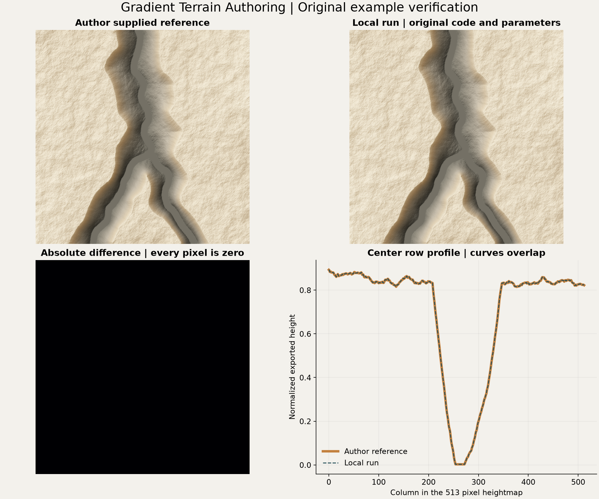
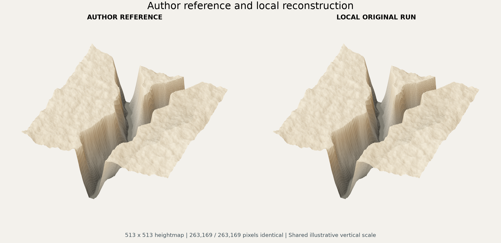

# Gradient Terrain Authoring 原始示例实测

2026 年 10 月 9 日在本机成功复现作者自带的峡谷示例。

## 结果

原版输出为 513 × 513 的高度图，263169 个像素与仓库附带结果完全一致，最大像素差和均方根误差均为零。程序退出码为零，单次完整进程耗时约 1.09 秒，包含初始化、文件读取、计算及写出，不能视为纯求解时间或大地图性能预测。

诊断程序仅在原始入口增加显卡信息、OpenGL 错误检查和浮点输出，求解器、着色器、输入和参数未改。诊断程序导出的 PGM 与原版输出相同。显卡为 NVIDIA GeForce RTX 5070 Ti，驱动版本为 596.21，所建上下文报告 OpenGL 4.1，所需计算功能在该驱动上运行成功。初始化、求解和回读后的 OpenGL 错误码均为零。

原始浮点值全部有限，范围约为负 0.003339 至 1.202146。17103 个固定高度点的最大误差为零。按作者着色器更新方程计算的残差均方根约为 0.00002070，最大值约为 0.00016421，单位为示例的归一化浮点高度。保留了作者的有限迭代次数，没有据此宣称达到任意精度的数学收敛。

作者 SavePGM 会按结果最小值和最大值重新归一化为 16 位整数。项目接入时应使用带明确标高的浮点输出，避免用此自动归一化流程破坏中心地形的绝对高度。原版与本地 PGM 文本文件的 SHA256 不同，但解析后的全部像素一致，比较结论以数值为准。

已目视检查二维阴影图、中央剖面和三维预览，参考与实测峡谷形态一致。三维预览每三点采样一次，两侧使用相同的示意垂直比例，不代表实际米制尺度或游戏材质。

## 来源与环境

作者仓库为 [Gradient Terrain Authoring](https://github.com/eric-guerin/gradient-terrains)，提交为 `68da08b1b75a1e2b5650b5045a62a435072e5874`，原始归档保存在 `source.zip`。解压的 37 个文件已逐一与归档核对 SHA256，全部未改。作者许可证及依赖许可保留在源码目录。

本机没有找到已安装的 Visual Studio C++ 编译工具，因此使用 [w64devkit](https://github.com/skeeto/w64devkit/releases/tag/v2.10.0) 便携版提供的 GCC 16.2.0 编译未经修改的三个 C++ 源文件，链接作者附带的 GLFW、GLEW DLL 和系统 OpenGL。该工具链归档的 SHA256 为 `18D0A4C71A166F8401AB6305781BEC5882B40B5E06BA9807C61CB5F3B3C6325E`。

编译器和用于制图的 Python 依赖放在项目 `Library/GradientTerrainExampleTools/` 缓存中，遵循现有 Library 忽略规则，未修改 Git 配置。没有系统安装或全局 PATH 修改。清理 Library 后需要重新准备这两项依赖。

## 复现与文件

先运行 `build_and_run.ps1` 编译并运行原始入口，再运行 `run_diagnostics.ps1` 生成诊断数据及分析图。脚本使用本机 Codex Python 路径。原版运行在独立的 `run/bin` 目录中，读取复制的输入，结果写到 `run/results`，作者附带的参考结果保留在 upstream 目录。

完整指标见 [verification.json](verification.json)，显卡日志见 [diagnostic.log](diagnostic.log)，原始文件核对见 [upstream-integrity.json](upstream-integrity.json)。

## 下一步边界

本轮确认原版重建程序可在本机复现。尚未验证任意 DEM 拼接、我们的过渡区输入生成、中心区域约束、大尺寸分块或 MapMagic 接入。正式场景与地形资源未修改。圈 1、圈 3 的自然衔接仍待使用真实数据做局部候选。
