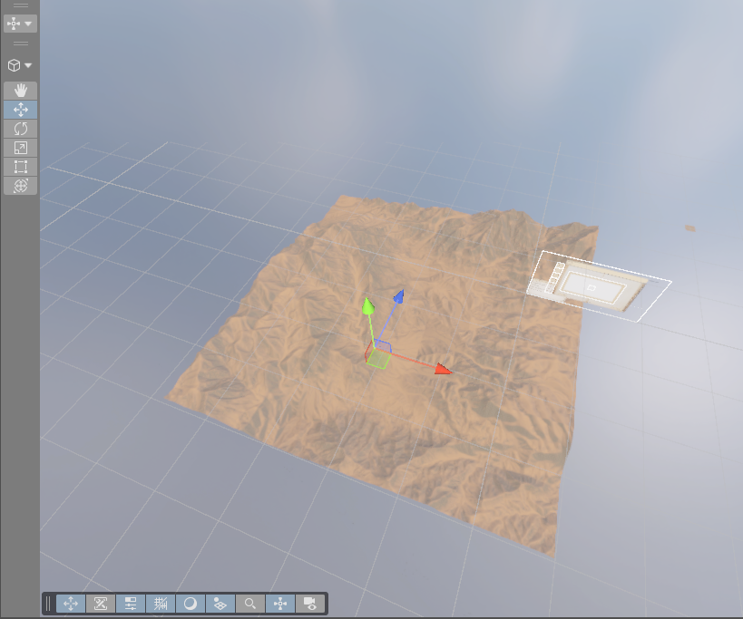
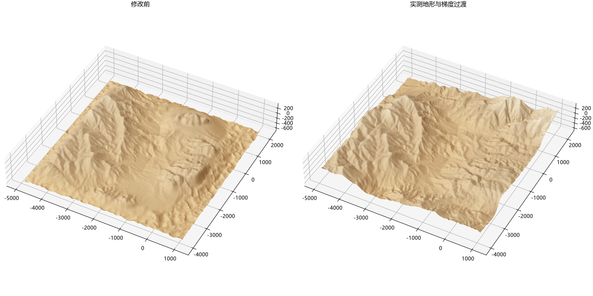

# 实测地形全覆盖

2026 年 10 月 10 日已应用并保存主场景。现有 6 公里见方地图使用实测 DEM 与梯度过渡，MapMagic 图中不再保留 Noise、Erosion、原覆盖遮罩及旧高度差分支。无限扩展已关闭，保留 36 个固定地块。

## 数据与处理

中心采用原 Sheep Range DEM 布局并保护现有精细地形。外围保留 A、B、C 片段的旋转、缩放与位置，C 片段在原摆放标高基础上降低 200 米。本轮取消程序地形回退和原山顶限高压缩，非过渡区直接保留源片段的实测起伏。

原有 x65y407、x65y408 文件之外，补取同测区 x66y407、x66y408、x65y406、x66y406。数据来自 [USGS 官方目录](https://rockyweb.usgs.gov/vdelivery/Datasets/Staged/Elevation/1m/Projects/NV_Southern_D23/TIFF/)，实际下载地址和哈希见 `source_downloads.json`。相邻图按地理坐标拼接并去除 12 像素重叠，NoData 不参与高度计算，未以边缘复制填补地图内缺失数据。下载缓存位于 `Library/NativeDEMOnlySources`。

继续使用 Gradient Terrain Authoring 的离散泊松方程。作者 GPU 求解器给出初值，Python 使用同一方程精化。源片段之间采用 800 米梯度混合，中心保留 24 米保护余量，固定区不参与求解。程序地形不再提供外围固定边界或过渡坡度。求解网格间距 2 米，打包时重新采样原 DEM 补回精细起伏，中心边缘仅用 32 米渐变衔接已有细节。

源数据自身存在极陡岩面。检查区分原始岩面与新增断层，例如北侧一处约 0.977 米水平距离内的 13.39 米高差可直接在原 DEM 复现。本轮未将这类实测岩面作为接缝错误削平。

## MapMagic 接入

`TerrainHeightSource` 读取 `SheepRange_Native_Main.asset` 与 `SheepRange_Native_Draft.asset`，同时接入 Height 输出和 HEIGHT 材质入口。图中仅保留该高度源、Height 输出、两只高度 Portal、Slope、Cavity、Textures 共 7 个节点。

Main 矩阵为 6209 方格，间距约 0.977 米，包含地图外 31.25 米采样余量。Draft 为 Main 每隔 8 个采样点抽取，矩阵为 777 方格。两级使用相同坐标和高度基准，旧修正矩阵不再叠加。旧资源保留供历史记录与恢复使用。

Terrain 存储范围由 1000 米增至 1100 米，基底仍为世界高度负 710 米。此次只重新编码现有地形并替换授权区域，未整体触发 MapMagic 生成。所有物体 Transform 保持原值。

每次改动源 DEM、片段摆放或过渡参数，必须重新离线求解并打包。不得仅更新源图后沿用旧过渡结果。写入后必须同步两级坡度材质及高度、材质边缘缓存，刷新热浪并保存场景。

## 检查

已检查 58 份实际 Terrain 回读。93 组同级地块边缘高差为零，22 组 Main 与 Draft 对应采样点高差为零。Draft 在中心原有的最大约 13.87 米偏差已对齐精细地形；低分辨率网格在采样点之间仍有正常的插值差异。

中心 Main 地形最大世界高度变化约 0.01532 米，属于存储换算量化。全部 21193 个物体 Transform、33 个 Lock 配置及 Main 保护区材质未变，Draft 材质按对齐后的高度重新计算。图副本对全部 58 份地形的采样验证通过，正式图无程序高度节点，所有高度与材质边缘缓存已核对。

详细证据见 `after-verification.json`、`graph-dry-run.json`、`solver-verification.json`、`persistence.json`。完整场景、图和地形备份位于 `Backup`，写入前后的浮点回读分别位于 `Before` 和 `After`。备份、中间数组、完整 Transform 快照、分批材质日志和临时视角记录仅保留本机。Play Mode 观感与切换仍待用户验收。

对比图采用相同物理比例与光照，仅表示高度表面，不包含 Unity 材质。

## 复现文件

`sources.py` 定义实测数据采样及片段布局，`prepare.py` 写求解输入，`solve.py` 精化作者 GPU 输出，`build_atlas.py` 打包两级数据，`verify.py` 检查保护区和接缝。Unity 侧依次使用 `create_assets.cs`、`dry_graph.cs`、`apply.cs`、`paint_batch.cs`、`readback.cs`、`finish.cs`。这些为本轮基准的一次性应用脚本，重做前须重新备份并核对当前高度哈希。
