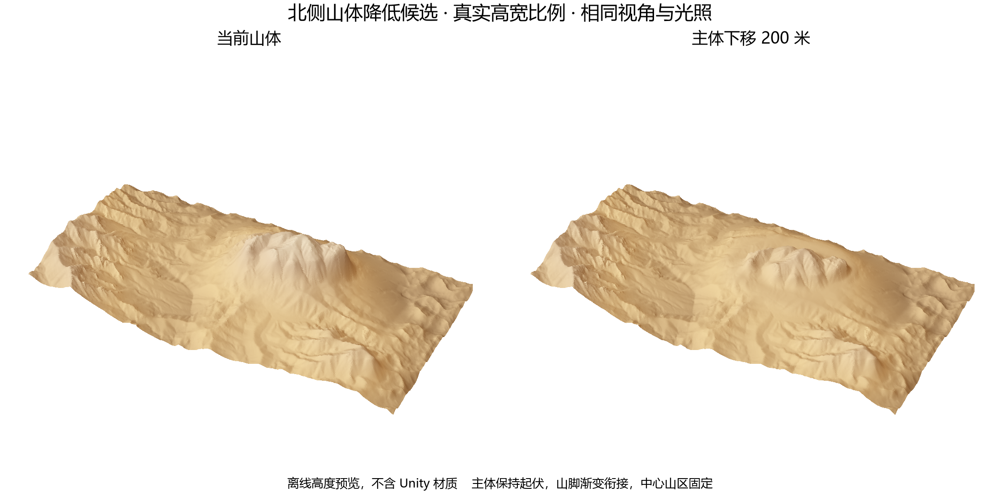

# 北侧山体降低 200 米

2026 年 10 月 10 日，按用户确认降低此前圈出的北侧外围山体，已写入实际地形并保存主场景。

后续全图实测高度源已替换此处差分接入，当前状态见[实测地形应用记录](../NativeDEMOnly/README.md)。以下保留本次应用时的检查结果。

## 范围与方法

使用 Tile 2,2 断层修复后的实际高度作为基准，58 份地形及全图修正矩阵均在应用前核对一致。完整场景、相关资源和原始数据保存在本目录 Backup 与 Before。

上部主体等量下移 200 米，保留内部起伏和坡度。山脚及保护区附近按约 800 米距离渐变衔接，结合原始地貌和低处约束收回降低量，避免挖出凹槽。过渡带坡形随降山改变。

将降低量合入现有全图修正矩阵，保留资源 GUID、节点和图连接。实际 TerrainData 仅写入新旧矩阵采样差值，未重新生成整张 MapMagic。

## 检查

13 份 Main 与 Draft 高度更新，45 份高度逐位不变。实际最大降幅约 199.994 米，最大高度写入量化误差约 0.015259 米。

中心保护区、已认可圈 1、修正范围外高度和贴图遮罩外数据保持不变。全部 21193 个物体 Transform 和 Lock 参数保持不变，索道站及塔架不在降山范围内。

58 份地形没有新增超过 85 度的相邻采样边，Tile 2,2 仍通过断层复现检查，其西、东、南三条 Main 接缝为零。Draft 接缝差异延续原值，本次最大缝差变化约 0.000060 米。

13 份高度与材质边缘缓存检查通过，坡度材质和 Factory Heat Haze 已刷新，主场景已保存。沙尘和热浪维持原先关闭状态，材质自动对齐保持开启。最终山体观感和 LOD 切换待 Play Mode 验收。

## 预览与记录

上述图采用真实高宽比例，表示离线高度表面，不含 Unity 材质。操作期间用户移动了 Scene 视角，现场截图不作为同机位对照。

`prepared.json` 记录局部写入范围，`graph-dry-run.json` 记录 11 份图副本采样检查，`verification.json` 记录保护区、材质与接缝检查，`slope-checks.json` 和 `Reproduction/reproduction.json` 记录断层检查，`persistence.json` 记录保存状态。

本目录脚本为一次性应用记录，不要重复执行高度写入。备份与中间数组按现有规则保留在本机。
