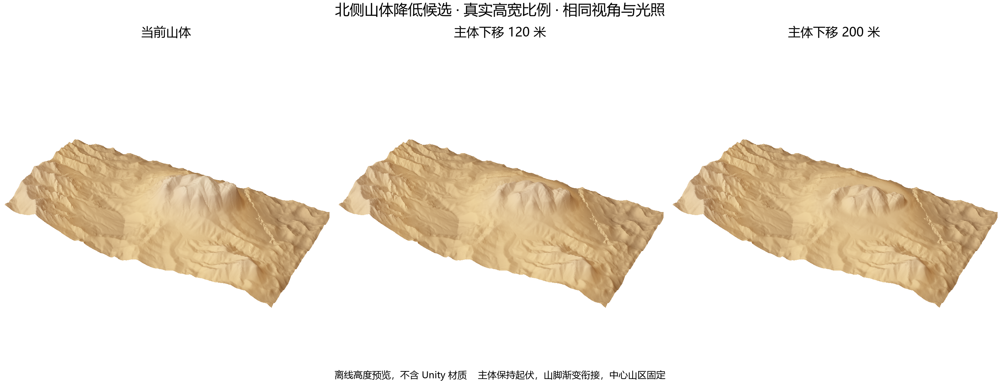
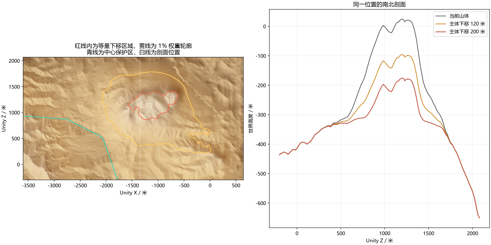

# 北侧山体降低预览

后续检查已确认预览基准包含 Tile 2,2 的高度硬切换断层，见[专项诊断](../Tile22CliffDiagnosis/README.md)。这两份候选需在断层修复后重做，目前不可直接应用。

2026 年 10 月 9 日，按用户圈出的北侧外围山体制作降低 120 米与 200 米的离线候选。先从 Unity 读取 58 份 MapMagic 地形的高度哈希，全部与上轮全图过渡的 After 回读一致，再使用这份浮点数据计算。本轮没有写入地形、生成图或保存场景。

## 对比

三维图采用实际高宽比例、相同视角和光照，是高度表面示意，不含 Unity 岩石材质。范围图的红线近似标出等量下移的上部主体，外围衔接带下移量逐渐减小。图中黄线为 1% 权重轮廓，外侧仍可能有很小的修正，真正范围外以 weight.npy 的零值为准。

## 方法与边界

候选高度等于当前高度减去指定下降量乘以局部权重。权重为一的位置等量下移，保留相邻点高差及坡度；山脚与保护区附近的权重逐渐回到零，接合带会改变坡形，不能把整个影响范围称为刚性平移。

东西两侧及南侧采用 800 米距离渐变，中心保护区外保留 24 米余量。为避免把山脚挖出凹槽，另根据外围组合前地貌与当前地貌的高差，在前 400 米高差内收回修正，并在当前世界高度负 450 米至零米之间逐渐增加降低量。上部主体满足全部条件时才得到完整的 120 米或 200 米下移。此前两轮只做距离渐变或只加原始地貌限制的内部试算出现山脚反坡，未应用到场景，当前文件为加入低处约束后的版本。

中心山区和已认可圈 1 的样本变化均为零，等量下移主体内部修正梯度为零，候选没有低于原本地形与外围组合前地貌两者中的较低值，也没有超出 Terrain 高度范围。检查基于离线浮点数组，最终局部写入和 LOD 验收尚未进行。

`preview.py` 生成候选及预览，`snapshot.json` 保存本轮实时核对，`verification.json` 记录数值检查，`candidate_120m.npy` 与 `candidate_200m.npy` 是候选世界高度。已有正式 TerrainHeightDelta 资源保持原值，若选择应用，应相对这次核对的基准生成新的高度差，并同步高度、材质、边缘缓存及热浪。
