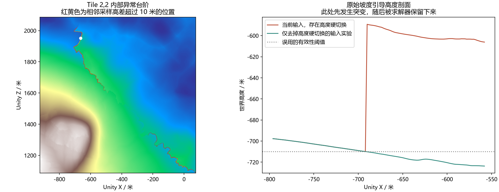

# Tile 2,2 内部垂直台阶诊断

后续已修正输入并完成[离线修复候选](../Tile22CliffRepairPreview/README.md)，原复现检查在候选上通过。正式场景尚未应用，下文保留发现问题时的证据。

2026 年 10 月 9 日，根据用户截图及 Unity 当前选中对象定位到 `Terrain/MapMagic/Tile 2,2/Main Terrain`。本轮读取高度并进行离线对照，未修改 TerrainData、MapMagic 图、生成脚本或场景。

## 实测

Main 高度采样间距为 0.9765625 米。内部最严重的一对 X 向相邻点位于世界 X 约负 663.2583 米、Z 约 1951.2345 米，高差 48.3733 米，对应坡度 88.8435 度。该点在检查时 Scene View 的归一化位置约为横向 0.319、纵向 0.420，与截图中可见的台阶带对应。Z 向最大相邻高差为 44.2227 米。西、东、南三条 Main 拼接边缘高差均为零，异常发生在本块内部。

同一对 X 向样本在外围山体应用前相差 0.3357 米，外围组合后及全图梯度过渡前相差 0.3662 米，全图过渡后变为 48.3733 米。实时高度与上次全图应用的回读哈希一致。

离线 candidate 已经包含同样的突变，排除了回写原生 Terrain 或自定义节点采样才产生断层的解释。异常两侧均在自由求解区，没有命中山脊固定区。

## 原因

当时的全图输入脚本将 `native > -710` 乘入原始 DEM 的混合权重，原版本现归档为 [prepare-before.py](../Tile22CliffRepairPreview/prepare-before.py)。负 710 米是当前 Unity Terrain 的世界高度下限，不能用来判定 DEM 测量数据是否有效。

局部取证中，相邻真实 DEM 高程为 1363.6911 米和 1363.4492 米。换算到世界高度后为负 709.9085 米与负 710.1504 米，恰好跨越这条判断。混合权重因此从一直接变成零，第二个点突然改用备用地形的负 589.2711 米，制造出约 120.6375 米的引导高度突变。泊松方程使用这个错误引导，求解残差很小也不能证明输入地貌正确。

保持其他输入不变，只在局部实验中移除这条高度判断，175 条跨阈值采样边的最大高差从 120.6375 米降至 0.5903 米。该实验只验证输入原因，并未重新求解全图或修复正式地形。

## 复现与后续

`snapshot.json` 与同目录浮点高度保存本轮实时读取数据。运行 `check.py` 会以断言失败复现块内近垂直台阶，测量结果保存到 `reproduction.json`。`trace.py` 对比各阶段与求解输入，结果为 `trace.json`。`probe_source.py` 重建错误权重并进行单变量对照，结果为 `source-probe.json`。

修复应先按实际 DEM 有效数据和覆盖范围处理输入，保持来源边界连续，再重新求解受影响区域。必须检查高度范围、块内梯度异常、保护区、Main 与 Draft 和接缝，随后局部写回并同步材质、缓存及热浪。直接平滑现有台阶或降低整片山体无法阻止错误输入再次生成台阶。

北侧降低 120 米与 200 米的现有候选以含此断层的高度为基准，需在本问题修复后重做，目前不可直接应用。
