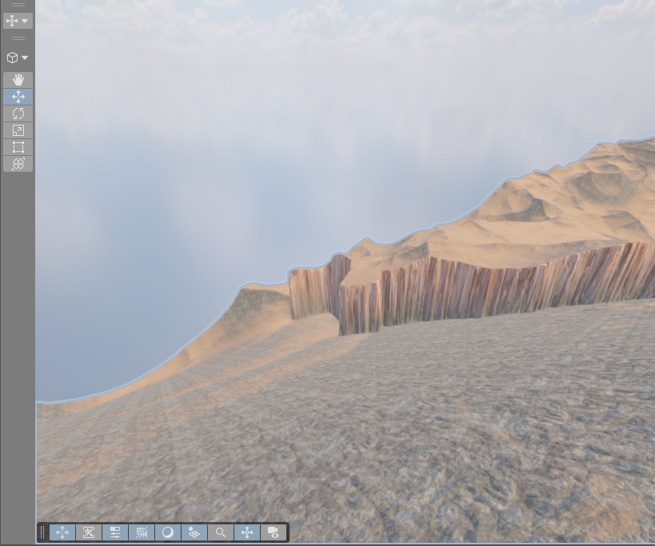
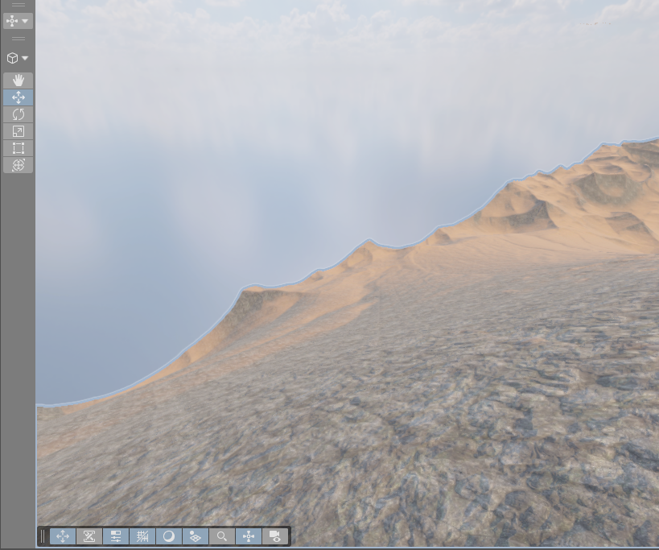

# Tile 2,2 断层修复应用记录

2026 年 10 月 9 日已应用并保存主场景。未整体重新生成 MapMagic，未应用北侧降低山体方案。

后续全图实测高度源已替换此处差分接入，当前状态见[实测地形应用记录](../../NativeDEMOnly/README.md)。以下保留本次应用时的检查结果。

## 实际效果

同一编辑器视角、相同光照与材质。截图时隐藏编辑器网格、Gizmos 和雾显示，完成后恢复原视角及显示设置。

## 写入范围

应用前，58 份实时高度和全图修正矩阵均与离线候选基准一致。Backup 保留磁盘场景、完整实时场景副本、TerrainData、生成图、修正矩阵及热浪资源。

保留原 TerrainHeightDelta 节点及资源 GUID，替换 `SheepRange_WholeMap_800m_delta.asset` 内的完整修正矩阵。实际地形只叠加新旧矩阵经同一 Unity 节点采样后的差值，避免重复叠加已应用的全图过渡。11 份 Main、Draft 及保护区样本的图副本试算通过。

局部写入 43 份 Main 与 Draft 高度，按新坡面同步局部材质及高度、材质边缘缓存。受 Terrain 高度量化影响，最终 26 份高度发生变化，32 份高度逐位不变。刷新 Factory Heat Haze 后保存主场景，沙尘和热浪保持原有关闭状态，材质自动对齐保持开启。

## 检查结果

截图中原 X 向 48.3733 米台阶降至 0.1831 米，Z 向 44.2227 米台阶降至 0.3052 米。Tile 2,2 超过 85 度的相邻采样边从 3047 条降至零。该块剩余约 83.5 度的最大坡度属于原有山体。

中心保护区、已认可圈 1、固定山脊、修正范围外高度和贴图遮罩外数据均不变。全部 21193 个物体 Transform、Lock 参数保持不变。受影响 Main 接缝仍为零，Draft 接缝差异延续原值，最大变化约 0.000030 米。

实际高度与准备写入值的最大差异为 0.015274 米。Main 与 Draft 在共同坐标上的修正差异最大为 0.030518 米，来自两级高度量化。43 份高度和材质边缘缓存与实际 TerrainData 一致。

主场景保存成功且无未保存标记，另一已打开场景未变脏。修正矩阵与候选一致，生成图仍为 18 个节点。Unity Console 未发现错误。最终游戏视角及 LOD 切换仍待 Play Mode 验收，原有 Draft 接缝尚未修复。

## 文件

`before.json`、`after.json` 保存应用前后状态，完整 Transform 快照仅保留本机。`prepared.json` 记录局部写入范围。`graph-dry-run.json`、`verification.json`、`height-checks.json`、`Reproduction/reproduction.json` 与 `persistence.json` 保存检查结果。

`backup.cs`、`sample_repair.cs`、`prepare_application.py`、`dry_graph.cs`、`apply_heights.cs`、`paint_batch.cs`、`readback.cs`、`verify_application.py`、`check_saved_heights.py`、`finish.cs` 是本次操作记录。不要重复执行高度写入。原始采样、备份及中间数组按现有规则只保留本机。
