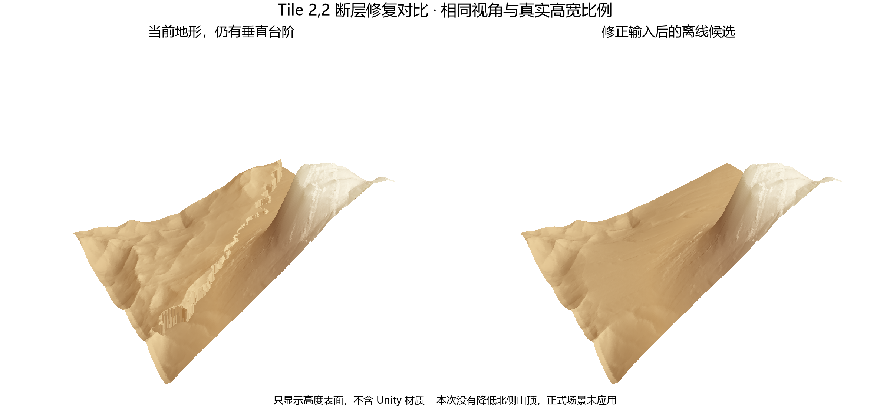
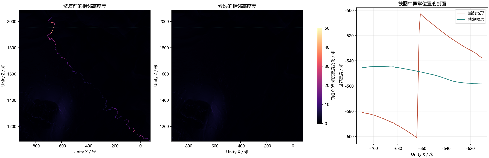

# Tile 2,2 断层离线修复候选

## 当前状态

2026 年 10 月 9 日已按用户确认局部应用到实际地形，并保存主场景。实际回读、同视角截图和备份说明见 [应用记录](Applied/README.md)。以下保留离线候选阶段的计算记录。

2026 年 10 月 9 日，按用户确认修正输入并离线重新求解。候选已经通过数值检查和高度表面对比，尚未写入 Unity 地形、生成图或场景，也没有应用北侧降低 120 米或 200 米的方案。

## 查看





[修正范围图](correction_map.png)显示变化主要集中在东北侧。图中绿色中心、紫色圈 1 和黑色固定山脊均保持原高。渲染采用实际高宽比例与相同光照，不含 Unity 材质。

## 改动

[原输入脚本](../WholeMapGradient800/prepare.py)去掉 `native > -710` 的高度硬切换。现在读取 TIFF 的 NoData 标记，检查所有非零覆盖权重处参与双线性采样的原始数据均有效；来源边缘继续使用已有连续覆盖权重。低于 Unity 世界高度下限的真实 DEM 仍可提供坡度引导，最终求解结果单独检查 Terrain 可表示范围。

保留 800 米坡度混合尺度、中心保护区、圈 1、主要山脊和全部固定高度约束，在原先的公共网格上重新求解。作者 GPU 求解器正常退出，OpenGL 错误码为零；SciPy 继续求解同一离散方程，3314 次迭代后最大方程残差约为 0.000000619 米。候选世界高度范围为负 678.7739 米至 108.3621 米。

`prepare.py` 和 `solve.py` 新增可选输出目录参数，本轮输出全部进入本目录，上次已应用数据仍保存在 `WholeMapGradient800`。修改前输入脚本归档为 `prepare-before.py`。

本轮高度修正为新旧求解候选之差，相对当前场景最高抬升约 53.51 米、最大下降约 71.64 米。`NativePreview` 将同一修正采样到 58 份原生高度网格并叠加在已核对的实时基准上，仅供离线验证，未导入资源。`Prepared/gradient_delta.f32` 则是修正后的完整全图 delta，相对于全图过渡应用前的基准，未来应替换旧全图 delta，不能再直接叠加到当前地形。

## 验证

截图定位的 X 向异常点，高差从 48.3733 米降为 0.1855 米；Z 向异常点从 44.2227 米降为 0.2983 米，水平采样间距均为 0.9765625 米。原复现脚本在旧数据上失败，在 `NativePreview` 上通过。

Tile 2,2 的 X 与 Z 相邻采样方向中，坡度超过 85 度的边从合计 3047 条降为零。该块剩余最大相邻高差约 8.5759 米，对应 83.50 度，位于原有陡峭山体并且在本次全图过渡前已经存在；本轮修复目标是错误输入产生的台阶。

全部 58 份原生网格检查通过。中心、圈 1、主要山脊、所有固定点以及修正为零的原生样本保持原值。相同精度区块间的接缝高差变化最多约 0.000179 米，Main 与 Draft 在共同坐标上的修正差最多约 0.000030 米。原有 Draft 接缝差异没有在本轮处理。

开始与结束时分别读取 Unity 实时高度，58 份高度哈希均与上次应用结果一致。正式场景本次未执行生成、写入或保存，游戏视角与材质效果尚未验收。

## 文件与复现

`live-before.json` 与 `live-after.json` 记录实时高度核对。`solver-verification.json` 记录方程结果，`verification.json` 记录保护范围、各块梯度、接缝及 LOD，`original-points-check.json` 记录截图异常点，`NativePreview/reproduction.json` 记录原复现检查通过后的结果。

在项目根目录用本机 Python 运行以下两个脚本，第二个参数都指定 `TerrainReferences/Tile22CliffRepairPreview`。两者之间，运行圈 1 保留的作者求解器。

```powershell
& 'C:/Users/Guanhao/.cache/codex-runtimes/codex-primary-runtime/dependencies/python/python.exe' 'TerrainReferences/WholeMapGradient800/prepare.py' 'TerrainReferences/Tile22CliffRepairPreview'

Push-Location 'TerrainReferences/Circle1GradientPreview/bin'
try {
    & './terrain-solver.exe' 'D:/Development/Game Dev/Project/Grad App Project/Project Coal/TerrainReferences/Tile22CliffRepairPreview/Solver' 3073
} finally {
    Pop-Location
}

& 'C:/Users/Guanhao/.cache/codex-runtimes/codex-primary-runtime/dependencies/python/python.exe' 'TerrainReferences/WholeMapGradient800/solve.py' 'TerrainReferences/Tile22CliffRepairPreview'
& 'C:/Users/Guanhao/.cache/codex-runtimes/codex-primary-runtime/dependencies/python/python.exe' 'TerrainReferences/Tile22CliffRepairPreview/verify.py'
& 'C:/Users/Guanhao/.cache/codex-runtimes/codex-primary-runtime/dependencies/python/python.exe' 'TerrainReferences/Tile22CliffDiagnosis/check.py' 'TerrainReferences/Tile22CliffRepairPreview/NativePreview'
& 'C:/Users/Guanhao/.cache/codex-runtimes/codex-primary-runtime/dependencies/python/python.exe' 'TerrainReferences/Tile22CliffRepairPreview/render.py'
```

后续若确认应用，先核对现场高度未变，备份场景与相关资源，替换全图修正矩阵并局部更新 TerrainData，再同步材质、两级边缘缓存、热浪和保存状态。降低北侧山体的候选应在本轮修复结果上另做。
